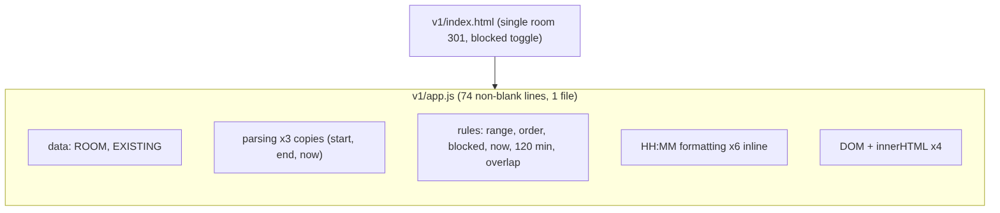
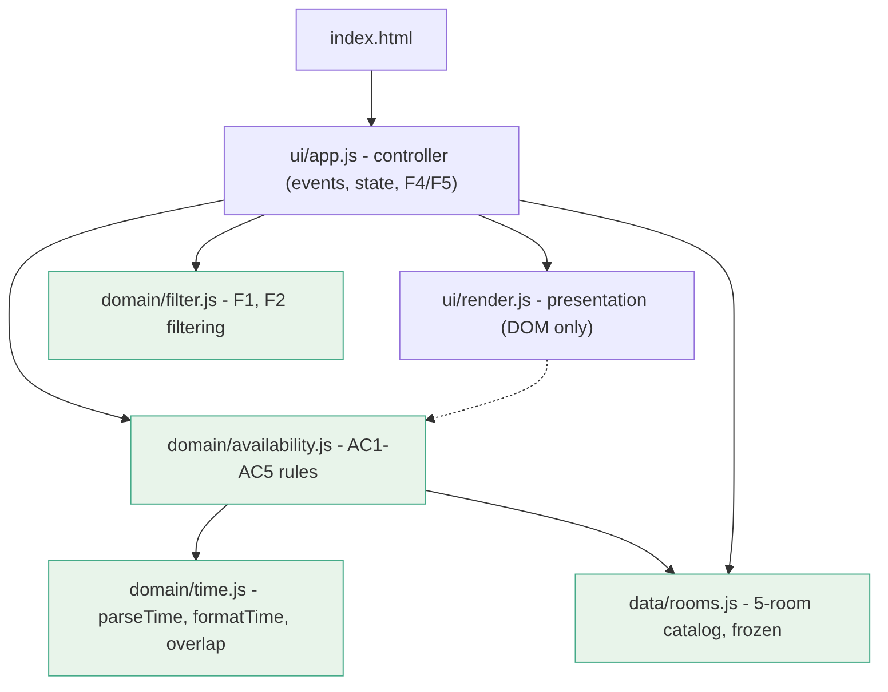

# Software Engineering – Assignment #04: Analysis & Refactoring Report

**Scenario:** Smart Campus Room Availability Checker  
**Student:** Ulykbek Dias (24B032168)  **AI assistant used:** Claude (Sonnet 5.5)  
**Baseline:** my Assignment #03 prototype (Room 301, AC1–AC6)  
**Git tags:** `v1-initial` (original) → `v2-final` (final); see `git log --oneline --decorate`

> **Scope note.** My Assignment #03 prototype was a Python `can_book` function plus a Bolt.new (Vite + React + TypeScript + Tailwind) page. For Assignment #04 I rebuilt that behaviour as a minimal plain HTML/JS version (`v1/`), taken from the behaviour documented in the Assignment #03 report (the assignment allows "an equivalent minimal version"). Messages, rule order and test inputs follow the Assignment #03 tables.

## Acceptance criteria preserved (from Assignment #03)

| ID | Criterion |
|---|---|
| AC1 | Times are integer minutes (HH:MM also accepted); 0 ≤ start < end ≤ 1440; start strictly after "now" |
| AC2 | Duration ≤ 120 minutes (exactly 120 is OK, 121 is rejected) |
| AC3 | A blocked room rejects everything |
| AC4 | Overlap with any booking is rejected; touching endpoints are not overlap |
| AC5 | Clear Available/Unavailable result; existing bookings never change; a stale result is cleared when inputs change |
| AC6 | Understandable messages (amber = malformed input, red = rule violation, green = available); usable at ~375 px |

New requirements: **F1** capacity ≥ attendees · **F2** ALL selected equipment · **F3** blocked ≠ available · **F4** empty state · **F5** switching room refreshes the result. Catalog: 5 fictional rooms (301 Lecture Hall, 302 Seminar Room, 210 Computer Lab, 115 Study Room, 401 Innovation Studio – blocked), each with ID, name, capacity, equipment, blocked flag and its own bookings.

**Intentional change:** in Assignment #03 "blocked" was a UI toggle; it is now a property of each room (needed for F3 and the catalog). The "current time" field stays editable, default 09:00.

---

## Task 1 – Codebase analysis

**Context given to the AI:** repository map (`v1/index.html`, `v1/app.js`, `v1/style.css`, `v1/baseline.test.js`), AC1–AC6, constraints (no login, payments, live APIs or database; fictional data; plain HTML/JS, no build step) and the instruction "analyse and propose a plan, do **not** edit code yet".

### Maintainability risks in v1

| # | Risk | Evidence (file / function) |
|---|---|---|
| 1 | **Duplicated time parsing** – the same HH:MM / digits-only parsing block is written 3 times (start, end, now) | `v1/app.js` → `checkAvailability` |
| 2 | **Duplicated HH:MM formatting** – 6 inline `padStart` pairs build the strings used in messages | `v1/app.js` → `checkAvailability` (now/start message, overlap message, success message) |
| 3 | **Duplicated rendering** – 4 separate `innerHTML` assignments (3 result branches + clearing); rendering by string concatenation is unsafe once names come from data | `v1/app.js` → click handler, `clearResult` |
| 4 | **Data, rules and UI in one file; one hard-coded room** – cannot support a catalog; the blocked state is a function parameter, not room data; rules return CSS class names (`kind: "err"`) | `v1/app.js` → `ROOM`, `EXISTING`, `checkAvailability` return values |

### Prioritised improvement plan (agreed before editing)
1. Extract pure modules (`time`, `availability`) that take `room` as an argument – fixes risks 1, 2, 4.
2. Data module with a deep-frozen catalog (≥4 rooms, each with its own bookings and blocked flag).
3. One renderer using `textContent` – fixes risk 3.
4. Thin controller; add F1–F5.
5. Run baseline tests on v1 first, then use the same inputs as a parity guard on v2, then add F-tests and DOM tests.

### AI suggestion rejected / AI output corrected
* **Rejected design alternative:** keep v1's return shape `{kind: "err"|"warn"|"ok", message}` and only move the functions into a new file. I rejected it: the domain now returns a semantic `status` (`available | invalid | unavailable`) plus a `reason` code, and a single `STATUS_CLASS` table in `ui/render.js` maps status → colour class. CSS vocabulary no longer lives inside business rules.
* **AI measurement error found:** a first duplication count reported 1 `innerHTML` in v2, but the match was a *comment*. I read the matches, changed the commands to ignore comment lines and re-ran all counts.

---

## Task 2 – Feature extension
* `src/data/rooms.js` – 5 fictional rooms; `src/domain/filter.js` – `filterRooms` (F1 `capacity >= attendees`, F2 `equipment.every(...)`) and `parseAttendees`.
* UI: attendees + equipment checkboxes (generated from the catalog) → radio list of matching rooms → start/end/now → result.
* F3: the blocked room stays listed with a **BLOCKED** badge (so users see why) but `checkAvailability` always returns `BLOCKED`.
* F4: "No rooms match your requirements…" and the Check button is disabled.
* F5: changing room re-runs the check if start and end are filled, otherwise clears the old result; filtering out the selected room clears selection and result.
* Demonstrated by automated tests (successful filter, unsuccessful filter, room switching, availability checks – `tests/ui.integration.test.js`) and a manual 375 px browser run (`docs/ui-mobile.png`: no horizontal overflow, no console errors).

---

## Task 3 – Refactoring

### Before (v1)

### After (v2)

### Design decisions
1. **Pure, DOM-free domain layer.** Rules take `room` and the raw request as arguments, so they run in Node, are boundary-testable, and cannot read another room's bookings.
2. **One source of truth per rule.** `parseTime` (parsing) and `formatTime` (formatting) exist once; `parseRequest` handles all amber validation, `checkAvailability` the red rules in the same order as v1.
3. **Presentation separated and safe.** `render.js` builds DOM with `textContent`, so catalog strings are never parsed as HTML.
4. **Immutable data** via `deepFreeze` keeps AC5 true by construction.

**Behaviour consistency:** `tests/parity.test.js` runs 23 input sets × {blocked, not blocked} through v1 and v2 and asserts the *same status and the same message* (46 comparisons, all identical).

---

## Task 4 – Automated testing
Runner: Node built-in `node:test`; `jsdom` for DOM tests.

| Command | Result (actual run) |
|---|---|
| `npm run test:v1` | **13 / 13 pass** (12 logic + 1 DOM test) – `results/v1-baseline-tests.txt` |
| `npm test` | **81 / 81 pass**, 0 fail – `results/v2-tests.txt` |

Breakdown of the 81: `regression.test.js` 14 (AC1–AC5) · `parity.test.js` 46 (v1 vs v2) · `filters.test.js` 9 (F1–F4) · `ui.integration.test.js` 12 (F1–F5, AC5, AC6 in a DOM). Without the 46 parity comparisons: 35 behaviour tests.
Boundaries: **120 vs 121 min**, **touching (560–600, 660–720) vs 1-minute overlap**, **start = now vs now+1**, **1440 vs 1441**, **capacity 24 vs 25 attendees** for the 24-seat lab, "all" vs "any" equipment.

**Do the tests detect bugs?** I injected 8 deliberate faults one at a time; each made tests fail, then I restored the code (81/81 again):

| Injected fault | Tests failed |
|---|---|
| overlap `<` → `<=` | 4 |
| max 120 → 121 | 3 |
| start strictly after now → `<` | 3 |
| blocked check removed | 15 |
| day end 1440 → 1441 | 19 |
| capacity `>=` → `>` | 1 |
| equipment `every` → `some` | 11 |
| controller always uses first room | 3 |

---

## Task 5 – Quality evaluation

| Measure | v1 (original) | v2 (final) | How obtained |
|---|---|---|---|
| Automated tests passed / total | 13 / 13 | 81 / 81 (35 without parity) | `node --test` output in `results/` |
| Time-parsing blocks | 3 | 1 | counted `split(":")` / parse blocks in `v1/app.js`; `parseTime` in `src/domain/time.js` |
| HH:MM formatting sites | 6 (12 `padStart` calls = 6 pairs) | 1 (`formatTime`, 2 calls) | count of `padStart(` in code lines (comments excluded) |
| Result-rendering sites (`innerHTML`) | 4 | 0 (1 `renderMessage`) | count of `innerHTML` in code lines |
| **Duplicated-logic locations** | **13** | **3** | sum of the three rows above (3+6+4 → 1+1+1) |
| **Removed** | – | **10** | 13 − 3 |
| Structure | 1 file: data + parsing + rules + UI | 6 modules: `data/rooms` (catalog), `domain/time` (parse/format/overlap), `domain/availability` (AC rules), `domain/filter` (F1/F2), `ui/render` (DOM output), `ui/app` (events/state) | file listing |
| Source size (non-blank lines) | 74 | 186 across 6 files (includes new features) | `grep -cv '^\s*$'` |

"Location" = a place where the same piece of logic is written out; counts are raw occurrences, not a quality score.

**Remaining limitations**
* Only a fixed day, no dates, time zones or recurring bookings; a successful check does not create a booking.
* DOM tests use jsdom, not a real browser; only one manual 375 px browser check was done and there is no automated accessibility or keyboard test.
* v1 is a re-creation from my Assignment #03 report, not the original Bolt.new code; parity is proven for 23 input sets, not every input.
* The "no rooms match" and "invalid attendees" messages share one area.
