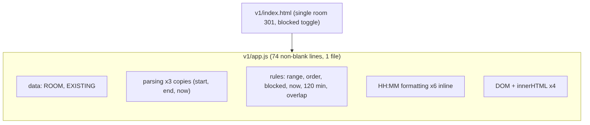
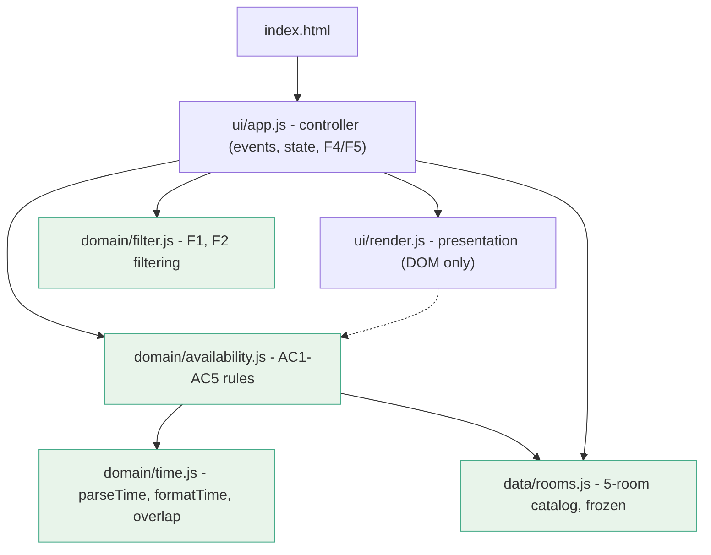

# Software Engineering – Assignment #04: Full Answers


**Scenario:** Smart Campus Room Availability Checker  
**Student:** Ulykbek Dias (24B032168)  **AI assistant used:** Claude (Sonnet 5.5)  
**Baseline:** my Assignment #03 prototype (Room 301, AC1–AC6)  
**Git tags:** `v1-initial` (original) → `v2-final` (final); see `git log --oneline --decorate`

> **Scope note.** My Assignment #03 prototype was a Python `can_book` function plus a Bolt.new (Vite + React + TypeScript + Tailwind) page. For Assignment #04 I rebuilt that behaviour as a minimal plain HTML/JS version (`v1/`), taken from the behaviour documented in the Assignment #03 report (the assignment allows "an equivalent minimal version"). Messages, rule order and test inputs follow the Assignment #03 tables.

## Acceptance criteria preserved (from Assignment #03)

| ID | Criterion |
|---|---|
| AC1 | Times are integer minutes (HH:MM also accepted); 0 ≤ start < end ≤ 1440; start strictly after "now" |
| AC2 | Duration ≤ 120 minutes (exactly 120 is OK, 121 is rejected) |
| AC3 | A blocked room rejects everything |
| AC4 | Overlap with any booking is rejected; touching endpoints are not overlap |
| AC5 | Clear Available/Unavailable result; existing bookings never change; a stale result is cleared when inputs change |
| AC6 | Understandable messages (amber = malformed input, red = rule violation, green = available); usable at ~375 px |

New requirements: **F1** capacity ≥ attendees · **F2** ALL selected equipment · **F3** blocked ≠ available · **F4** empty state · **F5** switching room refreshes the result. Catalog: 5 fictional rooms (301 Lecture Hall, 302 Seminar Room, 210 Computer Lab, 115 Study Room, 401 Innovation Studio – blocked), each with ID, name, capacity, equipment, blocked flag and its own bookings.

**Intentional change:** in Assignment #03 "blocked" was a UI toggle; it is now a property of each room (needed for F3 and the catalog). The "current time" field stays editable, default 09:00.

---

## Task 1 – Codebase analysis

> **Requirement (assignment slide):** Give your AI assistant a concise repository map, acceptance criteria and project constraints. Identify at least THREE maintainability risks, supported by file/function references. Propose a prioritized improvement plan before editing code. Explain one AI suggestion you rejected or modified.

**Answer**

**Context given to the AI:** repository map (`v1/index.html`, `v1/app.js`, `v1/style.css`, `v1/baseline.test.js`), AC1–AC6, constraints (no login, payments, live APIs or database; fictional data; plain HTML/JS, no build step) and the instruction "analyse and propose a plan, do **not** edit code yet".

### Maintainability risks in v1

| # | Risk | Evidence (file / function) |
|---|---|---|
| 1 | **Duplicated time parsing** – the same HH:MM / digits-only parsing block is written 3 times (start, end, now) | `v1/app.js` → `checkAvailability` |
| 2 | **Duplicated HH:MM formatting** – 6 inline `padStart` pairs build the strings used in messages | `v1/app.js` → `checkAvailability` (now/start message, overlap message, success message) |
| 3 | **Duplicated rendering** – 4 separate `innerHTML` assignments (3 result branches + clearing); rendering by string concatenation is unsafe once names come from data | `v1/app.js` → click handler, `clearResult` |
| 4 | **Data, rules and UI in one file; one hard-coded room** – cannot support a catalog; the blocked state is a function parameter, not room data; rules return CSS class names (`kind: "err"`) | `v1/app.js` → `ROOM`, `EXISTING`, `checkAvailability` return values |

### Prioritised improvement plan (agreed before editing)
1. Extract pure modules (`time`, `availability`) that take `room` as an argument – fixes risks 1, 2, 4.
2. Data module with a deep-frozen catalog (≥4 rooms, each with its own bookings and blocked flag).
3. One renderer using `textContent` – fixes risk 3.
4. Thin controller; add F1–F5.
5. Run baseline tests on v1 first, then use the same inputs as a parity guard on v2, then add F-tests and DOM tests.

### AI suggestion rejected / AI output corrected
* **Rejected design alternative:** keep v1's return shape `{kind: "err"|"warn"|"ok", message}` and only move the functions into a new file. I rejected it: the domain now returns a semantic `status` (`available | invalid | unavailable`) plus a `reason` code, and a single `STATUS_CLASS` table in `ui/render.js` maps status → colour class. CSS vocabulary no longer lives inside business rules.
* **AI measurement error found:** a first duplication count reported 1 `innerHTML` in v2, but the match was a *comment*. I read the matches, changed the commands to ignore comment lines and re-ran all counts.

---

## Task 2 – Feature extension

> **Requirement (assignment slide):** Add room catalog and filtering by capacity and equipment. Preserve original time and overlap validation. Use fictional data only; keep the interface responsive. Demonstrate successful and unsuccessful filtering, room switching, and availability checks.

**Answer**
* `src/data/rooms.js` – 5 fictional rooms; `src/domain/filter.js` – `filterRooms` (F1 `capacity >= attendees`, F2 `equipment.every(...)`) and `parseAttendees`.
* UI: attendees + equipment checkboxes (generated from the catalog) → radio list of matching rooms → start/end/now → result.
* F3: the blocked room stays listed with a **BLOCKED** badge (so users see why) but `checkAvailability` always returns `BLOCKED`.
* F4: "No rooms match your requirements…" and the Check button is disabled.
* F5: changing room re-runs the check if start and end are filled, otherwise clears the old result; filtering out the selected room clears selection and result.
* Demonstrated by automated tests (successful filter, unsuccessful filter, room switching, availability checks – `tests/ui.integration.test.js`) and a manual 375 px browser run (`docs/ui-mobile.png`: no horizontal overflow, no console errors).

---

## Task 3 – Refactoring

> **Requirement (assignment slide):** Separate room data, booking/availability rules, filtering logic and UI presentation. Reduce duplicated validation or rendering logic. Keep behavior consistent before and after refactoring. Supply a before/after module or component diagram and justify at least TWO design decisions.

**Answer**

### Before (v1)


### After (v2)


### Design decisions
1. **Pure, DOM-free domain layer.** Rules take `room` and the raw request as arguments, so they run in Node, are boundary-testable, and cannot read another room's bookings.
2. **One source of truth per rule.** `parseTime` (parsing) and `formatTime` (formatting) exist once; `parseRequest` handles all amber validation, `checkAvailability` the red rules in the same order as v1.
3. **Presentation separated and safe.** `render.js` builds DOM with `textContent`, so catalog strings are never parsed as HTML.
4. **Immutable data** via `deepFreeze` keeps AC5 true by construction.

**Behaviour consistency:** `tests/parity.test.js` runs 23 input sets × {blocked, not blocked} through v1 and v2 and asserts the *same status and the same message* (46 comparisons, all identical).

---

## Task 4 – Automated testing

> **Requirement (assignment slide):** Run at least TEN executable tests. Include original AC1–AC5 regression checks and new F1–F5 tests. Cover boundaries: exactly 120 vs 121 minutes; touching vs overlapping intervals; exact capacity vs insufficient capacity. Add at least ONE integration or UI behavior check. Record actual commands and pass/fail results.

**Answer**
Runner: Node built-in `node:test`; `jsdom` for DOM tests.

| Command | Result (actual run) |
|---|---|
| `npm run test:v1` | **13 / 13 pass** (12 logic + 1 DOM test) – `results/v1-baseline-tests.txt` |
| `npm test` | **81 / 81 pass**, 0 fail – `results/v2-tests.txt` |

Breakdown of the 81: `regression.test.js` 14 (AC1–AC5) · `parity.test.js` 46 (v1 vs v2) · `filters.test.js` 9 (F1–F4) · `ui.integration.test.js` 12 (F1–F5, AC5, AC6 in a DOM). Without the 46 parity comparisons: 35 behaviour tests.
Boundaries: **120 vs 121 min**, **touching (560–600, 660–720) vs 1-minute overlap**, **start = now vs now+1**, **1440 vs 1441**, **capacity 24 vs 25 attendees** for the 24-seat lab, "all" vs "any" equipment.

**Do the tests detect bugs?** I injected 8 deliberate faults one at a time; each made tests fail, then I restored the code (81/81 again):

| Injected fault | Tests failed |
|---|---|
| overlap `<` → `<=` | 4 |
| max 120 → 121 | 3 |
| start strictly after now → `<` | 3 |
| blocked check removed | 15 |
| day end 1440 → 1441 | 19 |
| capacity `>=` → `>` | 1 |
| equipment `every` → `some` | 11 |
| controller always uses first room | 3 |

---

## Task 5 – Quality evaluation

> **Requirement (assignment slide):** Compare original and final versions using a short evidence table: automated tests passed / total; number of duplicated logic locations removed; code structure (modules/components and responsibilities); at least one remaining limitation. Do not invent metrics; explain how each measure was obtained.

**Answer**

| Measure | v1 (original) | v2 (final) | How obtained |
|---|---|---|---|
| Automated tests passed / total | 13 / 13 | 81 / 81 (35 without parity) | `node --test` output in `results/` |
| Time-parsing blocks | 3 | 1 | counted `split(":")` / parse blocks in `v1/app.js`; `parseTime` in `src/domain/time.js` |
| HH:MM formatting sites | 6 (12 `padStart` calls = 6 pairs) | 1 (`formatTime`, 2 calls) | count of `padStart(` in code lines (comments excluded) |
| Result-rendering sites (`innerHTML`) | 4 | 0 (1 `renderMessage`) | count of `innerHTML` in code lines |
| **Duplicated-logic locations** | **13** | **3** | sum of the three rows above (3+6+4 → 1+1+1) |
| **Removed** | – | **10** | 13 − 3 |
| Structure | 1 file: data + parsing + rules + UI | 6 modules: `data/rooms` (catalog), `domain/time` (parse/format/overlap), `domain/availability` (AC rules), `domain/filter` (F1/F2), `ui/render` (DOM output), `ui/app` (events/state) | file listing |
| Source size (non-blank lines) | 74 | 186 across 6 files (includes new features) | `grep -cv '^\s*$'` |

"Location" = a place where the same piece of logic is written out; counts are raw occurrences, not a quality score.

**Remaining limitations**
* Only a fixed day, no dates, time zones or recurring bookings; a successful check does not create a booking.
* DOM tests use jsdom, not a real browser; only one manual 375 px browser check was done and there is no automated accessibility or keyboard test.
* v1 is a re-creation from my Assignment #03 report, not the original Bolt.new code; parity is proven for 23 input sets, not every input.
* The "no rooms match" and "invalid attendees" messages share one area.

---

## Task 6 – AI reflection

> **Requirement (assignment slide):** Write 200–300 words addressing: what context you provided the AI assistant; which generated suggestions were useful or incorrect; what you personally verified; how tests influenced your engineering decisions; what you would improve next.

**Answer** (about 250 words – edit so it matches what you personally did)


**Context.** I gave the assistant a concise repository map, the acceptance criteria AC1–AC6, the new requirements F1–F5 and the constraints (fictional data, fixed time 09:00, no login, payments, live APIs or database, no build step), and asked for analysis and a plan before any code.

**Useful vs incorrect.** The assistant correctly identified the duplicated validation, the duplicated 120-minute rule, the repeated `innerHTML` rendering and the untestable blocked-room branch, and proposed a layered domain/UI split that I adopted. One output was wrong: its first duplication count included a code comment, which I found by reading the grep matches and corrected.

**What I verified personally.** I ran the baseline tests on v1 before changing anything, then `npm test` after each change; I reviewed the diffs; I injected eight deliberate faults to confirm the tests really fail; I checked the page at phone width in a browser; and I re-ran every command behind the evidence table.

**Influence of tests.** The v1 baseline fixed the behaviour I had to preserve. The mutation check showed which boundaries were protected (120/121 minutes, start = now, touching vs overlapping, capacity 24 vs 25). A parity test that sends the same inputs through v1 and v2 let me refactor without changing a single message, and it drove passing the room as a parameter.

**Next.** I would add dates and recurring bookings, persist created bookings, test in a real browser with an accessibility audit and keyboard navigation, and separate the "no rooms match" and "invalid attendees" messages.


---

# Appendix A – Complete source code, original version (v1, tag `v1-initial`)

### `v1/index.html`

```html
<!doctype html>
<html lang="en">
<head>
  <meta charset="utf-8">
  <meta name="viewport" content="width=device-width, initial-scale=1">
  <title>Smart Campus - Room Availability (v1)</title>
  <link rel="stylesheet" href="style.css">
</head>
<body>
  <main>
    <h1>Room 301 - Lecture Hall (Floor 3)</h1>
    <p>Existing booking: 10:00-11:00 (600-660). Check a slot; this tool does not make bookings.</p>
    <label for="start">Start time</label>
    <input id="start" placeholder="HH:MM or minutes, e.g. 09:30">
    <label for="end">End time</label>
    <input id="end" placeholder="HH:MM or minutes, e.g. 10:30">
    <label for="now">Current time (now)</label>
    <input id="now" value="09:00">
    <label class="check"><input id="blocked" type="checkbox"> Room blocked</label>
    <button id="check" type="button">Check availability</button>
    <div id="result" role="status" aria-live="polite"></div>
  </main>
  <script src="app.js"></script>
</body>
</html>
```

### `v1/style.css`

```css
body { font-family: sans-serif; margin: 0; background: #f5f5f5; }
main { max-width: 480px; margin: 0 auto; padding: 16px; }
input:not([type]), button { width: 100%; box-sizing: border-box; padding: 10px; margin: 6px 0 12px; font-size: 1rem; }
#result { padding: 10px; border-radius: 6px; }
.ok { background: #d9f2d9; } .err { background: #f8d7da; } .warn { background: #fff3cd; }
@media (min-width: 600px) { main { padding: 32px; } }
```

### `v1/app.js`

```javascript
// Smart Campus - Room Availability Checker (v1 = Assignment #03 behaviour, single room, monolithic)
// Reconstructed from the Assignment #03 report (Bolt.new V3 final): one file holds data, parsing,
// validation, rules and DOM code. Times are integer minutes after midnight (HH:MM also accepted).

const ROOM = { id: "301", name: "Lecture Hall", floor: "Floor 3" };
const EXISTING = Object.freeze([Object.freeze({ start: 600, end: 660 })]); // 10:00-11:00

function checkAvailability(startText, endText, nowText, blocked) {
  let s, e, n;
  // --- parse start (copy 1)
  if (/^\d{1,2}:\d{2}$/.test(startText)) {
    const p = startText.split(":");
    s = parseInt(p[0]) * 60 + parseInt(p[1]);
  } else if (/^\d+$/.test(startText)) {
    s = parseInt(startText);
  } else {
    return { kind: "warn", message: "Start time must be HH:MM or minutes (0-1440)." };
  }
  // --- parse end (copy 2)
  if (/^\d{1,2}:\d{2}$/.test(endText)) {
    const p = endText.split(":");
    e = parseInt(p[0]) * 60 + parseInt(p[1]);
  } else if (/^\d+$/.test(endText)) {
    e = parseInt(endText);
  } else {
    return { kind: "warn", message: "End time must be HH:MM or minutes (0-1440)." };
  }
  // --- parse now (copy 3)
  if (/^\d{1,2}:\d{2}$/.test(nowText)) {
    const p = nowText.split(":");
    n = parseInt(p[0]) * 60 + parseInt(p[1]);
  } else if (/^\d+$/.test(nowText)) {
    n = parseInt(nowText);
  } else {
    return { kind: "warn", message: "Current time must be HH:MM or minutes (0-1439)." };
  }
  if (s < 0 || s > 1440) return { kind: "warn", message: "Start time must be between 0 and 1440." };
  if (e < 0 || e > 1440) return { kind: "warn", message: "End time must be between 0 and 1440." };
  if (s >= e) return { kind: "warn", message: "Start must be strictly before end." };

  if (blocked) return { kind: "err", message: "Room " + ROOM.id + " is currently blocked." };
  if (s <= n) {
    const sh = String(Math.floor(s / 60)).padStart(2, "0") + ":" + String(s % 60).padStart(2, "0");
    const nh = String(Math.floor(n / 60)).padStart(2, "0") + ":" + String(n % 60).padStart(2, "0");
    return { kind: "err", message: "Start (" + sh + ") must be strictly after the current time (" + nh + ")." };
  }
  if (e - s > 120) {
    return { kind: "err", message: "Duration is " + (e - s) + " min. Maximum allowed is 120 minutes." };
  }
  for (const b of EXISTING) {
    if (s < b.end && b.start < e) {
      const bs = String(Math.floor(b.start / 60)).padStart(2, "0") + ":" + String(b.start % 60).padStart(2, "0");
      const be = String(Math.floor(b.end / 60)).padStart(2, "0") + ":" + String(b.end % 60).padStart(2, "0");
      return { kind: "err", message: "Overlaps existing booking " + bs + "-" + be + " (" + b.start + "-" + b.end + ")." };
    }
  }
  const s2 = String(Math.floor(s / 60)).padStart(2, "0") + ":" + String(s % 60).padStart(2, "0");
  const e2 = String(Math.floor(e / 60)).padStart(2, "0") + ":" + String(e % 60).padStart(2, "0");
  return { kind: "ok", message: "Room " + ROOM.id + " is available " + s2 + "-" + e2 + "." };
}

if (typeof document !== "undefined") {
  const $ = (id) => document.getElementById(id);
  const clearResult = () => { $("result").innerHTML = ""; };
  $("check").addEventListener("click", () => {
    const r = checkAvailability($("start").value.trim(), $("end").value.trim(), $("now").value.trim(), $("blocked").checked);
    if (r.kind === "ok") {
      $("result").innerHTML = '<div class="ok">' + r.message + "</div>";
    } else if (r.kind === "warn") {
      $("result").innerHTML = '<div class="warn">' + r.message + "</div>";
    } else {
      $("result").innerHTML = '<div class="err">' + r.message + "</div>";
    }
  });
  ["start", "end", "now"].forEach((id) => $(id).addEventListener("input", clearResult));
  $("blocked").addEventListener("change", clearResult);
}

if (typeof module !== "undefined") module.exports = { checkAvailability, EXISTING, ROOM };
```

# Appendix B – Complete source code, final version (v2, tag `v2-final`)

### `index.html`

```html
<!doctype html>
<html lang="en">
<head>
  <meta charset="utf-8">
  <meta name="viewport" content="width=device-width, initial-scale=1">
  <title>Smart Campus - Room Availability (v2)</title>
  <link rel="stylesheet" href="style.css">
</head>
<body>
  <main>
    <h1>Smart Campus - Room Availability</h1>
    <p>Checks availability only - this tool does not make bookings.</p>

    <section aria-labelledby="req-h">
      <h2 id="req-h">1. Requirements</h2>
      <label for="attendees">Attendees (optional)</label>
      <input id="attendees" inputmode="numeric" placeholder="e.g. 25">
      <div id="attendees-error" class="field-error" role="alert"></div>
      <fieldset><legend>Required equipment (all must be present)</legend>
        <div id="equipment-group"></div>
      </fieldset>
    </section>

    <section aria-labelledby="room-h">
      <h2 id="room-h">2. Choose a room</h2>
      <div id="room-list"></div>
    </section>

    <section aria-labelledby="time-h">
      <h2 id="time-h">3. Check a time slot</h2>
      <label for="start">Start time</label>
      <input id="start" placeholder="HH:MM or minutes, e.g. 09:30">
      <label for="end">End time</label>
      <input id="end" placeholder="HH:MM or minutes, e.g. 10:30">
      <label for="now">Current time (now)</label>
      <input id="now" value="09:00">
      <button id="check" type="button">Check availability</button>
      <div id="result" role="status" aria-live="polite"></div>
    </section>
  </main>
  <script type="module">
    import { initApp } from "./src/ui/app.js";
    initApp(document);
  </script>
</body>
</html>
```

### `style.css`

```css
body { font-family: system-ui, sans-serif; margin: 0; background: #f5f5f5; }
main { max-width: 560px; margin: 0 auto; padding: 16px; }
section { background: #fff; border-radius: 8px; padding: 12px 16px; margin-bottom: 16px; }
h1 { font-size: 1.4rem; } h2 { font-size: 1.1rem; margin-top: 0; }
input[type=text], input:not([type]), button { width: 100%; box-sizing: border-box; padding: 10px; margin: 6px 0 12px; font-size: 1rem; }
button:disabled { opacity: .5; }
label.room, label.check { display: block; padding: 8px 0; }
.badge { background: #c0392b; color: #fff; border-radius: 4px; padding: 1px 6px; margin-left: 8px; font-size: .75rem; }
.empty { color: #7a4b00; background: #fff3cd; padding: 10px; border-radius: 6px; }
.field-error { color: #a1261b; min-height: 1.2em; }
#result > div { padding: 10px; border-radius: 6px; }
.ok { background: #d9f2d9; } .err { background: #f8d7da; } .warn { background: #fff3cd; }
@media (min-width: 600px) { main { padding: 32px; } }
```

### `src/data/rooms.js`

```javascript
// Fictional room catalog (data only - no logic). Deep-frozen so booking data is immutable (AC5).
// Times are integer minutes after midnight (600 = 10:00).
export const DEFAULT_NOW = "09:00"; // fixed starting "current time" (still editable in the UI, as in Assignment #03)

const deepFreeze = (o) => {
  Object.values(o).forEach((v) => typeof v === "object" && v !== null && deepFreeze(v));
  return Object.freeze(o);
};

export const ROOMS = deepFreeze([
  { id: "301", name: "Lecture Hall", floor: "Floor 3", capacity: 120, equipment: ["microphone", "projector", "whiteboard"],
    blocked: false, bookings: [{ start: 600, end: 660 }, { start: 900, end: 960 }] }, // 10:00-11:00 is the A#03 booking
  { id: "302", name: "Seminar Room", floor: "Floor 3", capacity: 30, equipment: ["projector", "whiteboard"],
    blocked: false, bookings: [{ start: 570, end: 630 }, { start: 840, end: 960 }] },
  { id: "210", name: "Computer Lab", floor: "Floor 2", capacity: 24, equipment: ["computers", "projector"],
    blocked: false, bookings: [{ start: 660, end: 780 }] },
  { id: "115", name: "Study Room", floor: "Floor 1", capacity: 6, equipment: ["whiteboard"],
    blocked: false, bookings: [{ start: 720, end: 750 }] },
  { id: "401", name: "Innovation Studio", floor: "Floor 4", capacity: 40, equipment: ["projector", "video-conference", "whiteboard"],
    blocked: true, bookings: [{ start: 600, end: 720 }] },
]);
```

### `src/domain/time.js`

```javascript
// Pure time helpers: the single source of truth for time parsing, formatting and interval maths.
// Times are integer minutes after midnight; input may be "HH:MM" or digits-only minutes.

/** "HH:MM" or digits-only minutes -> integer minutes, or null when the format is invalid. */
export function parseTime(text) {
  if (typeof text !== "string") return null;
  const hm = /^(\d{1,2}):(\d{2})$/.exec(text);
  if (hm) return Number(hm[1]) * 60 + Number(hm[2]);
  if (/^\d+$/.test(text)) return Number(text);
  return null;
}

/** minutes -> "HH:MM" (1440 -> "24:00"). */
export function formatTime(minutes) {
  return `${String(Math.floor(minutes / 60)).padStart(2, "0")}:${String(minutes % 60).padStart(2, "0")}`;
}

/** Half-open overlap: touching intervals (end === start) do NOT overlap. */
export function intervalsOverlap(aStart, aEnd, bStart, bEnd) {
  return aStart < bEnd && bStart < aEnd;
}
```

### `src/domain/availability.js`

```javascript
// Booking / availability rules (AC1-AC5). Pure functions: no DOM, no mutation.
import { parseTime, formatTime, intervalsOverlap } from "./time.js";
import { DEFAULT_NOW } from "../data/rooms.js";

export const MAX_MINUTES = 120;
export const DAY_END = 1440;

/** invalid = malformed input (amber) | unavailable = rule violation (red) | available (green) */
export const STATUS = Object.freeze({ AVAILABLE: "available", INVALID: "invalid", UNAVAILABLE: "unavailable" });

export const REASON = Object.freeze({
  START_FORMAT: "START_FORMAT", END_FORMAT: "END_FORMAT", NOW_FORMAT: "NOW_FORMAT",
  START_RANGE: "START_RANGE", END_RANGE: "END_RANGE", ORDER: "ORDER", NO_ROOM: "NO_ROOM",
  BLOCKED: "BLOCKED", NOT_AFTER_NOW: "NOT_AFTER_NOW", TOO_LONG: "TOO_LONG", OVERLAP: "OVERLAP",
  AVAILABLE: "AVAILABLE",
});

const invalid = (reason, message) => ({ status: STATUS.INVALID, reason, message });
const unavailable = (reason, message, extra = {}) => ({ status: STATUS.UNAVAILABLE, reason, message, ...extra });

/** AC1: parse and validate raw text. Returns {ok:true,s,e,n} or {ok:false,result}. Room-independent. */
export function parseRequest({ start, end, now = DEFAULT_NOW }) {
  const s = parseTime(start), e = parseTime(end), n = parseTime(now);
  if (s === null) return { ok: false, result: invalid(REASON.START_FORMAT, `Start time must be HH:MM or minutes (0-${DAY_END}).`) };
  if (e === null) return { ok: false, result: invalid(REASON.END_FORMAT, `End time must be HH:MM or minutes (0-${DAY_END}).`) };
  if (n === null) return { ok: false, result: invalid(REASON.NOW_FORMAT, `Current time must be HH:MM or minutes (0-${DAY_END - 1}).`) };
  if (s > DAY_END) return { ok: false, result: invalid(REASON.START_RANGE, `Start time must be between 0 and ${DAY_END}.`) };
  if (e > DAY_END) return { ok: false, result: invalid(REASON.END_RANGE, `End time must be between 0 and ${DAY_END}.`) };
  if (s >= e) return { ok: false, result: invalid(REASON.ORDER, "Start must be strictly before end.") };
  return { ok: true, s, e, n };
}

/** Checks ONE room using that room's own bookings only. Returns {status, reason, message, conflict?}. */
export function checkAvailability(room, request) {
  if (!room) return invalid(REASON.NO_ROOM, "Select a room first.");
  const p = parseRequest(request);
  if (!p.ok) return p.result;
  const { s, e, n } = p;
  if (room.blocked) return unavailable(REASON.BLOCKED, `Room ${room.id} is currently blocked.`);            // AC3
  if (s <= n) return unavailable(REASON.NOT_AFTER_NOW, `Start (${formatTime(s)}) must be strictly after the current time (${formatTime(n)}).`);
  if (e - s > MAX_MINUTES) return unavailable(REASON.TOO_LONG, `Duration is ${e - s} min. Maximum allowed is ${MAX_MINUTES} minutes.`); // AC2
  const conflict = room.bookings.find((b) => intervalsOverlap(s, e, b.start, b.end));                       // AC4
  if (conflict) {
    return unavailable(REASON.OVERLAP,
      `Overlaps existing booking ${formatTime(conflict.start)}-${formatTime(conflict.end)} (${conflict.start}-${conflict.end}).`, { conflict });
  }
  return { status: STATUS.AVAILABLE, reason: REASON.AVAILABLE, message: `Room ${room.id} is available ${formatTime(s)}-${formatTime(e)}.` };
}
```

### `src/domain/filter.js`

```javascript
// Room filtering rules (F1, F2). Pure functions.

/** Blank -> no capacity filter. Otherwise must be a whole number >= 1. */
export function parseAttendees(raw) {
  const text = String(raw ?? "").trim();
  if (text === "") return { ok: true, value: null };
  if (!/^\d+$/.test(text) || Number(text) < 1) return { ok: false, message: "Attendees must be a whole number of 1 or more." };
  return { ok: true, value: Number(text) };
}

/** F1: capacity >= attendees. F2: room has ALL required equipment items. */
export function filterRooms(rooms, { attendees = null, equipment = [] } = {}) {
  return rooms.filter((r) => (attendees === null || r.capacity >= attendees) && equipment.every((item) => r.equipment.includes(item)));
}

/** All distinct equipment items in the catalog, sorted - used to build the checkboxes. */
export function equipmentOptions(rooms) {
  return [...new Set(rooms.flatMap((r) => r.equipment))].sort();
}
```

### `src/ui/render.js`

```javascript
// Presentation only: builds DOM from view data. Uses textContent (no innerHTML) so data is never parsed as HTML.
import { STATUS } from "../domain/availability.js";

// One place that maps a result status to a CSS class (replaces the 3 duplicated branches of v1).
const STATUS_CLASS = {
  [STATUS.AVAILABLE]: "ok",    // green
  [STATUS.INVALID]: "warn",    // amber: malformed input
  [STATUS.UNAVAILABLE]: "err", // red: rule violation
};

function el(doc, tag, props = {}, text) {
  const node = doc.createElement(tag);
  Object.assign(node, props);
  if (text !== undefined) node.textContent = text;
  return node;
}

/** Single message renderer used for every result/hint/empty message. */
export function renderMessage(container, kind, message) {
  container.replaceChildren();
  if (!message) return;
  container.appendChild(el(container.ownerDocument, "div", { className: kind }, message));
}

export function renderResult(container, result) {
  renderMessage(container, STATUS_CLASS[result.status], result.message);
}

export function renderEquipmentCheckboxes(container, items) {
  const doc = container.ownerDocument;
  container.replaceChildren(
    ...items.map((item) => {
      const label = el(doc, "label", { className: "check" });
      label.append(el(doc, "input", { type: "checkbox", name: "equipment", value: item }), ` ${item}`);
      return label;
    }),
  );
}

export function renderRoomList(container, rooms, selectedId, emptyMessage) {
  const doc = container.ownerDocument;
  container.replaceChildren();
  if (rooms.length === 0) {
    container.appendChild(el(doc, "p", { className: "empty", id: "rooms-empty" }, emptyMessage));
    return;
  }
  for (const r of rooms) {
    const label = el(doc, "label", { className: "room" });
    const radio = el(doc, "input", { type: "radio", name: "room", value: r.id, checked: r.id === selectedId });
    const info = `Room ${r.id} - ${r.name} (${r.floor}) - capacity ${r.capacity} - ${r.equipment.join(", ")}`;
    label.append(radio, ` ${info}`);
    if (r.blocked) label.appendChild(el(doc, "span", { className: "badge" }, "BLOCKED"));
    container.appendChild(label);
  }
}
```

### `src/ui/app.js`

```javascript
// Controller: wires DOM events to the domain layer and the renderer. No business rules live here.
import { ROOMS, DEFAULT_NOW } from "../data/rooms.js";
import { checkAvailability } from "../domain/availability.js";
import { filterRooms, parseAttendees, equipmentOptions } from "../domain/filter.js";
import { renderResult, renderMessage, renderEquipmentCheckboxes, renderRoomList } from "./render.js";

export function initApp(doc, { rooms = ROOMS } = {}) {
  const $ = (id) => doc.getElementById(id);
  const state = { selectedId: null };

  renderEquipmentCheckboxes($("equipment-group"), equipmentOptions(rooms));

  const request = () => ({ start: $("start").value.trim(), end: $("end").value.trim(), now: $("now").value.trim() });
  const selectedRoom = () => rooms.find((r) => r.id === state.selectedId) ?? null;
  const hasTimes = () => request().start !== "" && request().end !== "";

  function refreshRooms() {
    const att = parseAttendees($("attendees").value);
    const equipment = [...doc.querySelectorAll('input[name="equipment"]:checked')].map((c) => c.value);
    $("attendees-error").textContent = att.ok ? "" : att.message;
    const visible = att.ok ? filterRooms(rooms, { attendees: att.value, equipment }) : [];
    if (!visible.some((r) => r.id === state.selectedId)) {
      state.selectedId = null; // selected room was filtered out
      renderMessage($("result"), "", "");
    }
    const empty = att.ok ? "No rooms match your requirements. Try fewer attendees or less equipment." : att.message;
    renderRoomList($("room-list"), visible, state.selectedId, empty);
    $("check").disabled = visible.length === 0;
  }

  function runCheck() {
    renderResult($("result"), checkAvailability(selectedRoom(), request()));
  }

  $("attendees").addEventListener("input", refreshRooms);
  $("equipment-group").addEventListener("change", refreshRooms);
  $("room-list").addEventListener("change", (ev) => {
    state.selectedId = ev.target.value;
    // F5: switching rooms refreshes the result for the new room, or clears it if no times were entered yet.
    if (hasTimes()) runCheck();
    else renderMessage($("result"), "", "");
  });
  $("check").addEventListener("click", runCheck);

  // AC5 (Assignment #03): any change to the time inputs clears a stale result.
  ["start", "end", "now"].forEach((id) => $(id).addEventListener("input", () => renderMessage($("result"), "", "")));

  refreshRooms();
  return { state, refreshRooms, runCheck };
}
```

### `package.json`

```json
{
  "name": "smart-campus-room-checker",
  "version": "2.0.0",
  "private": true,
  "type": "module",
  "scripts": {
    "start": "python3 -m http.server 8080",
    "test": "node --test \"tests/*.test.js\"",
    "test:v1": "cd v1 && node --test baseline.test.js"
  },
  "devDependencies": { "jsdom": "31.0.0" }
}
```

# Appendix C – Complete test code

### `v1/baseline.test.js`

```javascript
// Baseline tests: the Assignment #03 acceptance criteria (AC1-AC6) run against the ORIGINAL v1 code.
const test = require("node:test");
const assert = require("node:assert/strict");
const fs = require("node:fs");
const { JSDOM } = require("jsdom");
const { checkAvailability: check, EXISTING } = require("./app.js");

const NOW = "540"; // 09:00
const run = (s, e, blocked = false) => check(String(s), String(e), NOW, blocked);

test("AC4 free slot after the booking is available (660-720)", () => assert.equal(run(660, 720).kind, "ok"));
test("AC4 overlap is unavailable (630-690)", () => {
  const r = run(630, 690); assert.equal(r.kind, "err"); assert.match(r.message, /Overlaps existing booking 10:00-11:00/);
});
test("AC4 touching endpoints are not overlap (560-600 and 660-720)", () => {
  assert.equal(run(560, 600).kind, "ok"); assert.equal(run(660, 720).kind, "ok");
});
test("AC3 blocked room rejects everything, even a free slot", () => {
  assert.equal(run(660, 720, true).kind, "err"); assert.match(run(660, 720, true).message, /blocked/);
});
test("AC3 blocked + start = now reports blocked", () => assert.match(run(540, 570, true).message, /blocked/));
test("AC2 boundary: exactly 120 minutes allowed (720-840)", () => assert.equal(run(720, 840).kind, "ok"));
test("AC2 boundary: 121 minutes rejected (720-841)", () => {
  const r = run(720, 841); assert.equal(r.kind, "err"); assert.match(r.message, /121 min/);
});
test("AC1 start must be strictly after now (540-570 rejected, 541-570 ok)", () => {
  assert.equal(run(540, 570).kind, "err"); assert.equal(run(541, 570).kind, "ok");
});
test("AC1 reversed times give a message (700-650)", () => assert.equal(run(700, 650).kind, "warn"));
test("AC1 range: 1380-1440 ok, 1400-1441 rejected", () => {
  assert.equal(run(1380, 1440).kind, "ok"); assert.equal(run(1400, 1441).kind, "warn");
});
test("AC1 integer minutes / HH:MM only: 600.5 and 11:00:59 rejected, 10:30 accepted", () => {
  assert.equal(run("600.5", 660).kind, "warn"); assert.equal(run("11:00:59", "12:00").kind, "warn");
  assert.equal(check("10:30", "11:30", "09:00", false).kind, "err"); // overlaps booking, but parsed fine
});
test("AC5 existing bookings are immutable and unchanged by checks", () => {
  const before = JSON.stringify(EXISTING); run(630, 690); run(720, 840);
  assert.equal(JSON.stringify(EXISTING), before); assert.ok(Object.isFrozen(EXISTING) && Object.isFrozen(EXISTING[0]));
});
test("AC5/AC6 UI: stale result is cleared when the blocked toggle changes; messages are in a status region", () => {
  const dom = new JSDOM(fs.readFileSync(__dirname + "/index.html", "utf8"), { runScripts: "outside-only" });
  dom.window.eval(fs.readFileSync(__dirname + "/app.js", "utf8"));
  const d = dom.window.document, ev = (n, t) => n.dispatchEvent(new dom.window.Event(t, { bubbles: true }));
  d.getElementById("start").value = "660"; d.getElementById("end").value = "720";
  d.getElementById("check").click();
  assert.equal(d.querySelector("#result .ok") !== null, true);
  d.getElementById("blocked").checked = true; ev(d.getElementById("blocked"), "change");
  assert.equal(d.getElementById("result").textContent, "");
  assert.equal(d.getElementById("result").getAttribute("role"), "status");
});
```

### `tests/regression.test.js`

```javascript
// AC1-AC5 regression checks (the Assignment #03 acceptance criteria) against the refactored domain layer.
import test from "node:test";
import assert from "node:assert/strict";
import { ROOMS } from "../src/data/rooms.js";
import { checkAvailability, STATUS, REASON } from "../src/domain/availability.js";

const R301 = ROOMS.find((r) => r.id === "301");
const R401 = ROOMS.find((r) => r.id === "401"); // blocked
const NOW = "540"; // 09:00
const run = (s, e, room = R301) => checkAvailability(room, { start: String(s), end: String(e), now: NOW });

test("AC4 free slot after the booking is available (660-720)", () => assert.equal(run(660, 720).status, STATUS.AVAILABLE));
test("AC4 overlap is unavailable and names the booking (630-690)", () => {
  const r = run(630, 690);
  assert.equal(r.status, STATUS.UNAVAILABLE); assert.equal(r.reason, REASON.OVERLAP);
  assert.match(r.message, /Overlaps existing booking 10:00-11:00/);
});
test("AC4 boundary: touching endpoints are not overlap (560-600, 660-720); 1-minute overlap is", () => {
  assert.equal(run(560, 600).status, STATUS.AVAILABLE); assert.equal(run(660, 720).status, STATUS.AVAILABLE);
  assert.equal(run(560, 601).reason, REASON.OVERLAP);
});
test("AC3 blocked room rejects everything, even a free slot (660-720)", () => {
  const r = run(660, 720, R401); assert.equal(r.reason, REASON.BLOCKED); assert.equal(r.status, STATUS.UNAVAILABLE);
});
test("AC3 blocked + start = now still reports blocked", () => assert.equal(run(540, 570, R401).reason, REASON.BLOCKED));
test("AC2 boundary: exactly 120 minutes allowed (720-840)", () => assert.equal(run(720, 840).status, STATUS.AVAILABLE));
test("AC2 boundary: 121 minutes rejected (720-841)", () => {
  const r = run(720, 841); assert.equal(r.reason, REASON.TOO_LONG); assert.match(r.message, /121 min/);
});
test("AC1 start must be strictly after now (540 rejected, 541 accepted)", () => {
  assert.equal(run(540, 570).reason, REASON.NOT_AFTER_NOW); assert.equal(run(541, 570).status, STATUS.AVAILABLE);
});
test("AC1 reversed or equal times give an amber message (700-650, 700-700)", () => {
  assert.equal(run(700, 650).status, STATUS.INVALID); assert.equal(run(700, 650).reason, REASON.ORDER);
  assert.equal(run(700, 700).reason, REASON.ORDER);
});
test("AC1 range: 1380-1440 allowed, 1400-1441 rejected", () => {
  assert.equal(run(1380, 1440).status, STATUS.AVAILABLE); assert.equal(run(1400, 1441).reason, REASON.END_RANGE);
});
test("AC1 integer minutes / HH:MM only: floats, sci-notation, hex, HH:MM:SS, negatives rejected", () => {
  for (const bad of ["600.5", "1e3", "0x2d0", "11:00:59", "-30", "abc", ""]) {
    assert.equal(run(bad, 700).reason, REASON.START_FORMAT, bad);
  }
  assert.equal(checkAvailability(R301, { start: "09:30", end: "10:30", now: "09:00" }).reason, REASON.OVERLAP); // HH:MM parsed
});
test("AC5 booking data is immutable and unchanged by checks", () => {
  const before = JSON.stringify(ROOMS); run(630, 690); run(720, 840);
  assert.equal(JSON.stringify(ROOMS), before);
  assert.ok(Object.isFrozen(R301.bookings) && Object.isFrozen(R301.bookings[0]));
  assert.throws(() => R301.bookings.push({}), TypeError);
});
test("Room data separation: result uses the chosen room's own bookings only", () => {
  const R210 = ROOMS.find((r) => r.id === "210");
  assert.equal(run(600, 630, R301).reason, REASON.OVERLAP);      // 301 booked 10:00-11:00
  assert.equal(run(600, 630, R210).status, STATUS.AVAILABLE);    // 210 booked 11:00-13:00
});
test("No room selected gives an amber message", () => assert.equal(checkAvailability(null, { start: "600", end: "630" }).reason, REASON.NO_ROOM));
```

### `tests/parity.test.js`

```javascript
// Behaviour parity: the SAME inputs must give the SAME status and message in v1 (original) and v2 (refactored).
import test from "node:test";
import assert from "node:assert/strict";
import { createRequire } from "node:module";
import { ROOMS } from "../src/data/rooms.js";
import { checkAvailability, STATUS } from "../src/domain/availability.js";

const v1 = createRequire(import.meta.url)("../v1/app.js");
const room301 = ROOMS.find((r) => r.id === "301");
const KIND = { ok: STATUS.AVAILABLE, warn: STATUS.INVALID, err: STATUS.UNAVAILABLE };

// Compare on v1's single booking (10:00-11:00) so room data is identical: use a 301 copy with only that booking.
const room = { ...room301, bookings: [{ start: 600, end: 660 }] };
const blockedRoom = { ...room, blocked: true };

const cases = [
  ["660", "720", "540"], ["630", "690", "540"], ["560", "600", "540"], ["720", "840", "540"], ["720", "841", "540"],
  ["540", "570", "540"], ["541", "570", "540"], ["700", "650", "540"], ["700", "700", "540"], ["1380", "1440", "540"],
  ["1400", "1441", "540"], ["600.5", "660", "540"], ["1e3", "1100", "540"], ["0x2d0", "0x2e0", "540"], ["11:00:59", "12:00", "540"],
  ["-30", "30", "0"], ["10:30", "11:30", "09:00"], ["09:30", "10:30", "09:00"], ["24:00", "25:00", "540"], ["600", "660", "abc"],
  ["", "", "540"], ["1380", "1440", "1439"], ["100", "200", "100"],
];

for (const [s, e, n] of cases) {
  for (const blocked of [false, true]) {
    test(`parity: ${s}-${e} now=${n} blocked=${blocked}`, () => {
      const a = v1.checkAvailability(s, e, n, blocked);
      const b = checkAvailability(blocked ? blockedRoom : room, { start: s, end: e, now: n });
      assert.equal(KIND[a.kind], b.status);
      assert.equal(a.message, b.message);
    });
  }
}
```

### `tests/filters.test.js`

```javascript
// F1-F4 filtering rules (domain level).
import test from "node:test";
import assert from "node:assert/strict";
import { ROOMS } from "../src/data/rooms.js";
import { filterRooms, parseAttendees, equipmentOptions } from "../src/domain/filter.js";

const ids = (rs) => rs.map((r) => r.id);

test("catalog has at least four rooms with required fields", () => {
  assert.ok(ROOMS.length >= 4);
  for (const r of ROOMS) {
    assert.ok(r.id && r.name && r.capacity > 0 && Array.isArray(r.equipment) && typeof r.blocked === "boolean" && Array.isArray(r.bookings));
  }
});
test("F1 capacity boundary: exact capacity matches, one more does not", () => {
  assert.ok(ids(filterRooms(ROOMS, { attendees: 24 })).includes("210")); // capacity 24 == 24
  assert.ok(!ids(filterRooms(ROOMS, { attendees: 25 })).includes("210")); // 25 > 24
});
test("F1 no capacity filter when attendees is null", () => {
  assert.equal(filterRooms(ROOMS, { attendees: null }).length, ROOMS.length);
});
test("F2 equipment filter requires ALL selected items", () => {
  assert.deepEqual(ids(filterRooms(ROOMS, { equipment: ["projector", "whiteboard"] })), ["301", "302", "401"]);
  assert.deepEqual(ids(filterRooms(ROOMS, { equipment: ["computers", "whiteboard"] })), []); // no room has both
});
test("F1+F2 combined", () => {
  assert.deepEqual(ids(filterRooms(ROOMS, { attendees: 35, equipment: ["video-conference"] })), ["401"]);
});
test("F3 blocked rooms still listed but flagged (availability blocks them, see regression tests)", () => {
  const r = filterRooms(ROOMS, { attendees: 35, equipment: ["video-conference"] })[0];
  assert.equal(r.blocked, true);
});
test("F4 impossible requirements give an empty list", () => {
  assert.deepEqual(filterRooms(ROOMS, { attendees: 500 }), []);
});
test("attendee input parsing", () => {
  assert.deepEqual(parseAttendees(""), { ok: true, value: null });
  assert.deepEqual(parseAttendees(" 25 "), { ok: true, value: 25 });
  for (const bad of ["0", "-3", "2.5", "abc"]) assert.equal(parseAttendees(bad).ok, false, bad);
});
test("equipment options are derived from the catalog", () => {
  assert.deepEqual(equipmentOptions(ROOMS), ["computers", "microphone", "projector", "video-conference", "whiteboard"]);
});
```

### `tests/ui.integration.test.js`

```javascript
// Integration / UI behaviour checks: real index.html + real controller in a jsdom DOM.
import test from "node:test";
import assert from "node:assert/strict";
import { readFileSync } from "node:fs";
import { JSDOM } from "jsdom";
import { initApp } from "../src/ui/app.js";

const html = readFileSync(new URL("../index.html", import.meta.url), "utf8");

function setup() {
  const dom = new JSDOM(html);
  const { document } = dom.window;
  initApp(document);
  const $ = (id) => document.getElementById(id);
  const fire = (node, type) => node.dispatchEvent(new dom.window.Event(type, { bubbles: true }));
  const type = (id, value) => { $(id).value = value; fire($(id), "input"); };
  const tick = (value) => { const c = document.querySelector(`input[name=equipment][value="${value}"]`); c.checked = true; fire(c, "change"); };
  const pick = (id) => { const r = document.querySelector(`input[name=room][value="${id}"]`); r.checked = true; fire(r, "change"); };
  const roomIds = () => [...document.querySelectorAll("input[name=room]")].map((r) => r.value);
  return { document, $, type, tick, pick, roomIds, click: (id) => $(id).dispatchEvent(new dom.window.Event("click", { bubbles: true })) };
}

test("UI: all rooms listed initially; result region is an aria-live status (AC6)", () => {
  const { roomIds, $ } = setup();
  assert.equal(roomIds().length, 5);
  assert.equal($("result").getAttribute("role"), "status");
  assert.equal($("result").getAttribute("aria-live"), "polite");
});
test("UI: successful filtering (capacity + equipment) shows only matching rooms", () => {
  const { roomIds, type, tick } = setup();
  type("attendees", "35"); tick("projector");
  assert.deepEqual(roomIds(), ["301", "401"]);
});
test("UI: unsuccessful filtering shows empty state and disables the check button (F4)", () => {
  const { document, $, type } = setup();
  type("attendees", "500");
  assert.equal(roomIds2(document).length, 0);
  assert.match($("rooms-empty").textContent, /No rooms match/);
  assert.equal($("check").disabled, true);
});
test("UI: invalid attendees shows a clear error", () => {
  const { $, type } = setup();
  type("attendees", "-2");
  assert.match($("attendees-error").textContent, /whole number/);
});
test("UI: availability check uses the CHOSEN room's bookings", () => {
  const { $, type, pick, click } = setup();
  type("start", "10:00"); type("end", "10:30");
  pick("301"); click("check");
  assert.match($("result").textContent, /Overlaps existing booking 10:00-11:00/);
  pick("210"); click("check");
  assert.match($("result").textContent, /Room 210 is available/);
});
test("UI F5: switching rooms refreshes the result when times are entered", () => {
  const { $, type, pick } = setup();
  type("start", "10:00"); type("end", "10:30");
  pick("301"); // no click needed: the change event re-checks
  assert.equal($("result").firstElementChild.className, "err");
  pick("115");
  assert.equal($("result").firstElementChild.className, "ok");
});
test("UI F5: switching rooms with no times entered clears the old result", () => {
  const { $, type, pick } = setup();
  type("start", "10:00"); type("end", "10:30"); pick("301");
  assert.notEqual($("result").textContent, "");
  type("start", ""); type("end", ""); // typing clears the result as well
  pick("302");
  assert.equal($("result").textContent, "");
});
test("UI F3: blocked room is badged and reported blocked (red), never available", () => {
  const { document, $, type, pick } = setup();
  type("start", "900"); type("end", "960");
  pick("401");
  assert.match($("result").textContent, /Room 401 is currently blocked/);
  assert.equal($("result").firstElementChild.className, "err");
  assert.match(document.body.textContent, /BLOCKED/);
});
test("UI: filtering out the selected room clears selection and result", () => {
  const { $, type, tick, pick, roomIds } = setup();
  type("start", "10:00"); type("end", "10:30");
  pick("301");
  tick("computers"); // only room 210 has computers
  assert.deepEqual(roomIds(), ["210"]);
  assert.equal($("result").textContent, "");
});
test("UI AC5(A#03): editing any time input clears a stale result", () => {
  const { $, type, pick, click } = setup();
  type("start", "660"); type("end", "720"); pick("302"); click("check");
  assert.equal($("result").firstElementChild.className, "ok");
  type("now", "10:00");
  assert.equal($("result").textContent, "");
});
test("UI AC1/AC6: malformed input gives an amber message; rule violation gives a red one", () => {
  const { $, type, pick, click } = setup();
  pick("301"); type("start", "abc"); type("end", "700"); click("check");
  assert.equal($("result").firstElementChild.className, "warn");
  type("start", "720"); type("end", "841"); click("check");
  assert.equal($("result").firstElementChild.className, "err");
  assert.match($("result").textContent, /Duration is 121 min/);
});
test("UI AC6: the page has a mobile viewport meta tag and a stylesheet", () => {
  const { document } = setup();
  assert.match(document.querySelector('meta[name="viewport"]').content, /width=device-width/);
  assert.ok(document.querySelector('link[rel="stylesheet"]'));
});
function roomIds2(document) { return [...document.querySelectorAll("input[name=room]")]; }
```

# Appendix D – Actual test results

Command: `npm run test:v1` (original version)

```
# Subtest: AC4 free slot after the booking is available (660-720)
ok 1 - AC4 free slot after the booking is available (660-720)
# Subtest: AC4 overlap is unavailable (630-690)
ok 2 - AC4 overlap is unavailable (630-690)
# Subtest: AC4 touching endpoints are not overlap (560-600 and 660-720)
ok 3 - AC4 touching endpoints are not overlap (560-600 and 660-720)
# Subtest: AC3 blocked room rejects everything, even a free slot
ok 4 - AC3 blocked room rejects everything, even a free slot
# Subtest: AC3 blocked + start = now reports blocked
ok 5 - AC3 blocked + start = now reports blocked
# Subtest: AC2 boundary: exactly 120 minutes allowed (720-840)
ok 6 - AC2 boundary: exactly 120 minutes allowed (720-840)
# Subtest: AC2 boundary: 121 minutes rejected (720-841)
ok 7 - AC2 boundary: 121 minutes rejected (720-841)
# Subtest: AC1 start must be strictly after now (540-570 rejected, 541-570 ok)
ok 8 - AC1 start must be strictly after now (540-570 rejected, 541-570 ok)
# Subtest: AC1 reversed times give a message (700-650)
ok 9 - AC1 reversed times give a message (700-650)
# Subtest: AC1 range: 1380-1440 ok, 1400-1441 rejected
ok 10 - AC1 range: 1380-1440 ok, 1400-1441 rejected
# Subtest: AC1 integer minutes / HH:MM only: 600.5 and 11:00:59 rejected, 10:30 accepted
ok 11 - AC1 integer minutes / HH:MM only: 600.5 and 11:00:59 rejected, 10:30 accepted
# Subtest: AC5 existing bookings are immutable and unchanged by checks
ok 12 - AC5 existing bookings are immutable and unchanged by checks
# Subtest: AC5/AC6 UI: stale result is cleared when the blocked toggle changes; messages are in a status region
ok 13 - AC5/AC6 UI: stale result is cleared when the blocked toggle changes; messages are in a status region
# tests 13
# suites 0
# pass 13
# fail 0
# cancelled 0
# skipped 0
# todo 0
# duration_ms 421.150425
```

Command: `npm test` (final version)

```
# Subtest: catalog has at least four rooms with required fields
ok 1 - catalog has at least four rooms with required fields
# Subtest: F1 capacity boundary: exact capacity matches, one more does not
ok 2 - F1 capacity boundary: exact capacity matches, one more does not
# Subtest: F1 no capacity filter when attendees is null
ok 3 - F1 no capacity filter when attendees is null
# Subtest: F2 equipment filter requires ALL selected items
ok 4 - F2 equipment filter requires ALL selected items
# Subtest: F1+F2 combined
ok 5 - F1+F2 combined
# Subtest: F3 blocked rooms still listed but flagged (availability blocks them, see regression tests)
ok 6 - F3 blocked rooms still listed but flagged (availability blocks them, see regression tests)
# Subtest: F4 impossible requirements give an empty list
ok 7 - F4 impossible requirements give an empty list
# Subtest: attendee input parsing
ok 8 - attendee input parsing
# Subtest: equipment options are derived from the catalog
ok 9 - equipment options are derived from the catalog
# Subtest: parity: 660-720 now=540 blocked=false
ok 10 - parity: 660-720 now=540 blocked=false
# Subtest: parity: 660-720 now=540 blocked=true
ok 11 - parity: 660-720 now=540 blocked=true
# Subtest: parity: 630-690 now=540 blocked=false
ok 12 - parity: 630-690 now=540 blocked=false
# Subtest: parity: 630-690 now=540 blocked=true
ok 13 - parity: 630-690 now=540 blocked=true
# Subtest: parity: 560-600 now=540 blocked=false
ok 14 - parity: 560-600 now=540 blocked=false
# Subtest: parity: 560-600 now=540 blocked=true
ok 15 - parity: 560-600 now=540 blocked=true
# Subtest: parity: 720-840 now=540 blocked=false
ok 16 - parity: 720-840 now=540 blocked=false
# Subtest: parity: 720-840 now=540 blocked=true
ok 17 - parity: 720-840 now=540 blocked=true
# Subtest: parity: 720-841 now=540 blocked=false
ok 18 - parity: 720-841 now=540 blocked=false
# Subtest: parity: 720-841 now=540 blocked=true
ok 19 - parity: 720-841 now=540 blocked=true
# Subtest: parity: 540-570 now=540 blocked=false
ok 20 - parity: 540-570 now=540 blocked=false
# Subtest: parity: 540-570 now=540 blocked=true
ok 21 - parity: 540-570 now=540 blocked=true
# Subtest: parity: 541-570 now=540 blocked=false
ok 22 - parity: 541-570 now=540 blocked=false
# Subtest: parity: 541-570 now=540 blocked=true
ok 23 - parity: 541-570 now=540 blocked=true
# Subtest: parity: 700-650 now=540 blocked=false
ok 24 - parity: 700-650 now=540 blocked=false
# Subtest: parity: 700-650 now=540 blocked=true
ok 25 - parity: 700-650 now=540 blocked=true
# Subtest: parity: 700-700 now=540 blocked=false
ok 26 - parity: 700-700 now=540 blocked=false
# Subtest: parity: 700-700 now=540 blocked=true
ok 27 - parity: 700-700 now=540 blocked=true
# Subtest: parity: 1380-1440 now=540 blocked=false
ok 28 - parity: 1380-1440 now=540 blocked=false
# Subtest: parity: 1380-1440 now=540 blocked=true
ok 29 - parity: 1380-1440 now=540 blocked=true
# Subtest: parity: 1400-1441 now=540 blocked=false
ok 30 - parity: 1400-1441 now=540 blocked=false
# Subtest: parity: 1400-1441 now=540 blocked=true
ok 31 - parity: 1400-1441 now=540 blocked=true
# Subtest: parity: 600.5-660 now=540 blocked=false
ok 32 - parity: 600.5-660 now=540 blocked=false
# Subtest: parity: 600.5-660 now=540 blocked=true
ok 33 - parity: 600.5-660 now=540 blocked=true
# Subtest: parity: 1e3-1100 now=540 blocked=false
ok 34 - parity: 1e3-1100 now=540 blocked=false
# Subtest: parity: 1e3-1100 now=540 blocked=true
ok 35 - parity: 1e3-1100 now=540 blocked=true
# Subtest: parity: 0x2d0-0x2e0 now=540 blocked=false
ok 36 - parity: 0x2d0-0x2e0 now=540 blocked=false
# Subtest: parity: 0x2d0-0x2e0 now=540 blocked=true
ok 37 - parity: 0x2d0-0x2e0 now=540 blocked=true
# Subtest: parity: 11:00:59-12:00 now=540 blocked=false
ok 38 - parity: 11:00:59-12:00 now=540 blocked=false
# Subtest: parity: 11:00:59-12:00 now=540 blocked=true
ok 39 - parity: 11:00:59-12:00 now=540 blocked=true
# Subtest: parity: -30-30 now=0 blocked=false
ok 40 - parity: -30-30 now=0 blocked=false
# Subtest: parity: -30-30 now=0 blocked=true
ok 41 - parity: -30-30 now=0 blocked=true
# Subtest: parity: 10:30-11:30 now=09:00 blocked=false
ok 42 - parity: 10:30-11:30 now=09:00 blocked=false
# Subtest: parity: 10:30-11:30 now=09:00 blocked=true
ok 43 - parity: 10:30-11:30 now=09:00 blocked=true
# Subtest: parity: 09:30-10:30 now=09:00 blocked=false
ok 44 - parity: 09:30-10:30 now=09:00 blocked=false
# Subtest: parity: 09:30-10:30 now=09:00 blocked=true
ok 45 - parity: 09:30-10:30 now=09:00 blocked=true
# Subtest: parity: 24:00-25:00 now=540 blocked=false
ok 46 - parity: 24:00-25:00 now=540 blocked=false
# Subtest: parity: 24:00-25:00 now=540 blocked=true
ok 47 - parity: 24:00-25:00 now=540 blocked=true
# Subtest: parity: 600-660 now=abc blocked=false
ok 48 - parity: 600-660 now=abc blocked=false
# Subtest: parity: 600-660 now=abc blocked=true
ok 49 - parity: 600-660 now=abc blocked=true
# Subtest: parity: - now=540 blocked=false
ok 50 - parity: - now=540 blocked=false
# Subtest: parity: - now=540 blocked=true
ok 51 - parity: - now=540 blocked=true
# Subtest: parity: 1380-1440 now=1439 blocked=false
ok 52 - parity: 1380-1440 now=1439 blocked=false
# Subtest: parity: 1380-1440 now=1439 blocked=true
ok 53 - parity: 1380-1440 now=1439 blocked=true
# Subtest: parity: 100-200 now=100 blocked=false
ok 54 - parity: 100-200 now=100 blocked=false
# Subtest: parity: 100-200 now=100 blocked=true
ok 55 - parity: 100-200 now=100 blocked=true
# Subtest: AC4 free slot after the booking is available (660-720)
ok 56 - AC4 free slot after the booking is available (660-720)
# Subtest: AC4 overlap is unavailable and names the booking (630-690)
ok 57 - AC4 overlap is unavailable and names the booking (630-690)
# Subtest: AC4 boundary: touching endpoints are not overlap (560-600, 660-720); 1-minute overlap is
ok 58 - AC4 boundary: touching endpoints are not overlap (560-600, 660-720); 1-minute overlap is
# Subtest: AC3 blocked room rejects everything, even a free slot (660-720)
ok 59 - AC3 blocked room rejects everything, even a free slot (660-720)
# Subtest: AC3 blocked + start = now still reports blocked
ok 60 - AC3 blocked + start = now still reports blocked
# Subtest: AC2 boundary: exactly 120 minutes allowed (720-840)
ok 61 - AC2 boundary: exactly 120 minutes allowed (720-840)
# Subtest: AC2 boundary: 121 minutes rejected (720-841)
ok 62 - AC2 boundary: 121 minutes rejected (720-841)
# Subtest: AC1 start must be strictly after now (540 rejected, 541 accepted)
ok 63 - AC1 start must be strictly after now (540 rejected, 541 accepted)
# Subtest: AC1 reversed or equal times give an amber message (700-650, 700-700)
ok 64 - AC1 reversed or equal times give an amber message (700-650, 700-700)
# Subtest: AC1 range: 1380-1440 allowed, 1400-1441 rejected
ok 65 - AC1 range: 1380-1440 allowed, 1400-1441 rejected
# Subtest: AC1 integer minutes / HH:MM only: floats, sci-notation, hex, HH:MM:SS, negatives rejected
ok 66 - AC1 integer minutes / HH:MM only: floats, sci-notation, hex, HH:MM:SS, negatives rejected
# Subtest: AC5 booking data is immutable and unchanged by checks
ok 67 - AC5 booking data is immutable and unchanged by checks
# Subtest: Room data separation: result uses the chosen room's own bookings only
ok 68 - Room data separation: result uses the chosen room's own bookings only
# Subtest: No room selected gives an amber message
ok 69 - No room selected gives an amber message
# Subtest: UI: all rooms listed initially; result region is an aria-live status (AC6)
ok 70 - UI: all rooms listed initially; result region is an aria-live status (AC6)
# Subtest: UI: successful filtering (capacity + equipment) shows only matching rooms
ok 71 - UI: successful filtering (capacity + equipment) shows only matching rooms
# Subtest: UI: unsuccessful filtering shows empty state and disables the check button (F4)
ok 72 - UI: unsuccessful filtering shows empty state and disables the check button (F4)
# Subtest: UI: invalid attendees shows a clear error
ok 73 - UI: invalid attendees shows a clear error
# Subtest: UI: availability check uses the CHOSEN room's bookings
ok 74 - UI: availability check uses the CHOSEN room's bookings
# Subtest: UI F5: switching rooms refreshes the result when times are entered
ok 75 - UI F5: switching rooms refreshes the result when times are entered
# Subtest: UI F5: switching rooms with no times entered clears the old result
ok 76 - UI F5: switching rooms with no times entered clears the old result
# Subtest: UI F3: blocked room is badged and reported blocked (red), never available
ok 77 - UI F3: blocked room is badged and reported blocked (red), never available
# Subtest: UI: filtering out the selected room clears selection and result
ok 78 - UI: filtering out the selected room clears selection and result
# Subtest: UI AC5(A\#03): editing any time input clears a stale result
ok 79 - UI AC5(A\#03): editing any time input clears a stale result
# Subtest: UI AC1/AC6: malformed input gives an amber message; rule violation gives a red one
ok 80 - UI AC1/AC6: malformed input gives an amber message; rule violation gives a red one
# Subtest: UI AC6: the page has a mobile viewport meta tag and a stylesheet
ok 81 - UI AC6: the page has a mobile viewport meta tag and a stylesheet
# tests 81
# suites 0
# pass 81
# fail 0
# cancelled 0
# skipped 0
# todo 0
# duration_ms 768.136264
```

Full raw output: `results/v1-baseline-tests.txt`, `results/v2-tests.txt`. Screenshot at 375 px width: `docs/ui-mobile.png`.

# Appendix E – AI-use record

## 1. AI-use record

| # | Tool / date | Prompt summary | Output used | Problems found | Changes made | Verification source |
|---|---|---|---|---|---|---|
| 1 | Claude, 2026-11-07 | Attached the Assignment #04 slides and my Assignment #03 report; asked to complete the work with a step-by-step guide | Task plan; project layout; decision to rebuild v1 as a minimal HTML/JS version from the Assignment #03 report (my Bolt/Python code was not attached) | First draft of v1 used my own invented AC wording (HH:MM only, no "now" field) instead of my Assignment #03 rules | Rebuilt v1 and v2 to the Assignment #03 rules: minutes, "now", blocked, Room 301 booking 10:00–11:00 | Compared against the Assignment #03 tables (3.1, 3.2) and slides 9–23 |
| 2 | Claude | Baseline: monolithic single-room v1 + tests for AC1–AC6 | `v1/app.js`, `v1/baseline.test.js` | A jsdom test failed first because scripts were not executed | Added `runScripts: "outside-only"` | `npm run test:v1` → 13/13 pass |
| 3 | Claude | Analysis prompt: repo map + AC + constraints → ≥3 risks with file/function references and a prioritised plan, no code edits | Risk table and plan in `docs/REPORT.md` (Task 1) | Return shape with CSS `kind` strings judged a poor fit | Replaced by semantic `status` + `error` codes (see report) | Manual read of `v1/app.js`; `grep` counts |
| 4 | Claude | Implement the plan one module at a time (data → time → availability → filter → render → controller) | `src/**`, `index.html`, `style.css` | None at first run | Reviewed `git diff v1-initial v2-final` | `npm test` → 81/81; browser check at 375 px width: no overflow, no console errors |
| 5 | Claude | Write tests: AC regression, v1-vs-v2 parity, filters, DOM integration | `tests/*.test.js` (81 tests) | One test failed: a catalog booking (780–840) clashed with the 720–840 boundary case | Moved that booking to 900–960; kept the test | Output in report Task 4 table |
| 6 | Claude | Compute quality evidence | Evidence table | First `innerHTML` count in v2 matched a code **comment** (reported 1, true value 0) | Re-ran with comment lines excluded; all counts re-checked | `grep` commands listed in report Task 5 |

## 2. Selected prompts (condensed)

1. *"Here is the repo map, acceptance criteria AC1–AC6 and constraints (fictional data, fixed time 09:00, no login/payments/APIs/DB, no build step). Identify ≥3 maintainability risks with file/function references and propose a prioritised plan. Do not edit code yet."*
2. *"Implement step 1 of the plan only (extract `time.js` and `availability.js` as pure functions). Keep every v1 message unchanged. Do not touch the UI."*
3. *"Add room catalog (≥4 rooms) and `filterRooms` for capacity ≥ attendees and ALL equipment. Blocked rooms must never be reported available."*
4. *"Write executable tests: AC1–AC5 regression (using my Assignment #03 test table), F1–F5, boundaries 120/121 min, touching vs overlap, exact vs insufficient capacity, a v1-vs-v2 parity test, plus DOM integration tests."*

## 3. Decisions and human review

* Kept blocked rooms **visible with a badge** in filter results instead of hiding them – hiding would make F3 untestable at UI level and confuse users.
* Chose `node:test` + `jsdom` and plain JS instead of re-using React/Vite from Bolt.new, to keep the project small and runnable with no build step.
* Made "blocked" a property of each room (it was a UI toggle in Assignment #03) because the new requirements need a per-room blocked status.
* Rejected returning CSS class names from domain code (see report, Task 1).
* Human verification: ran every test command myself, inspected the diff between tags, ran mutation checks, opened the page in a browser, re-ran all `grep` commands.

---

